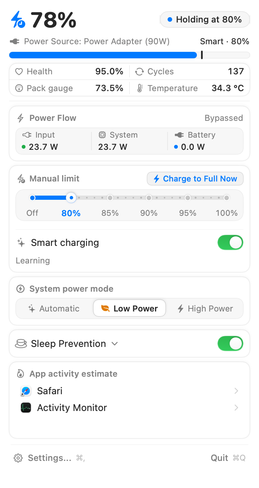

# Coddle

[English](README.en.md) · [简体中文](README.md)

**A native macOS menu bar companion for battery health and background workflows.**

Set a custom charge limit for desk work, top up before heading out, and keep long compiles, downloads, or automated tasks running quietly while your display sleeps. Charging routines are learned strictly on-device, respecting your privacy and hardware boundaries.

[GitHub Source](https://github.com/MrEasonYang/coddle) · [Website](https://coddle.kyun.si/) · [Download Latest macOS Preview (Universal)](https://github.com/MrEasonYang/coddle/releases/latest) · [Installation Notes](https://coddle.kyun.si/install.html)

> [!NOTE]
> **0.2.1 Early Preview**, targeting Apple Silicon and Intel Macs (macOS 13.0+ deployment target). Currently ad-hoc signed and **not Developer ID signed or notarized by Apple**. Native charge limits rely on Apple Silicon and recent macOS releases; feature availability is determined at runtime via dynamic hardware capability checks. Refer to the [installation notes](https://coddle.kyun.si/install.html) before first launch.



*Real application screenshot showing sample telemetry data. Fully localized in English, Chinese, and other languages.*

## Usage Scenarios

### 1. Desk Work: Cap Charging Limit

1. Click Coddle in the menu bar and select your desired charge limit (such as **80%**) using the **Manual limit** slider.
2. The panel immediately reflects the confirmed control state and live power metrics. On supported hardware, once the limit is reached, power bypass (Input directly powering the System) and lower battery power draw can be observed; exact telemetry varies with Mac model and system load. Lowering the limit does not actively discharge the battery; the charge level settles naturally with usage. Under certain conditions (such as battery calibration), macOS may temporarily override user charge limits.
3. To automate around your routine, enable **Smart charging** and configure holding levels and top-up lead time in settings. Once sufficient local samples are recorded, Coddle estimates your unplug schedule (showing "Learning" until ready). Smart charging relies on local historical heuristics and cannot guarantee a full charge when you unplug; moving the slider manually reverts back to a fixed limit at any time.

### 2. Heading Out: One-Click Temporary Full Charge

When supported by your hardware, connected to power, not yet full, and with a limit below 100% active:
- Click **Charge to Full Now** in the panel to temporarily raise the limit to 100% without modifying your everyday baseline configuration.
- Click the dynamic **Resume N% Limit** button at any time to end the top-up early. Unplugging the power cable or reaching a full 100% charge also restores your previous charge limit policy automatically.

### 3. Background Workloads: Run with Screen Off or Lid Closed

1. Toggle on **Sleep Prevention** in the panel while keeping **Keep display on** unchecked. Your Mac stays awake to finish downloads, compiles, renders, or automated runs, while the screen sleeps on schedule according to your system energy settings.
2. Expand the options to enable **Keep display on** or **Keep running with lid closed** (both can be combined). Closed-lid operation requires installing the optional privileged helper; closed-lid operation does not promise sustained maximum clocks or a cool enclosure.
3. When your task finishes, toggle off **Sleep Prevention**. Turning it off disables the child options while preserving your display and lid preferences for next time. It initiates an asynchronous request to halt Coddle's sleep prevention effects; if the stop cannot be confirmed immediately, the panel retains status indicators and offers a retry. Coddle does not detect when external tasks end; reopening the app while the main toggle remains on will attempt to resume keep-awake assertions.

## Installation and Quick Start

1. **Download**: Grab the latest [universal preview ZIP from GitHub Releases](https://github.com/MrEasonYang/coddle/releases/latest), extract it, and move `Coddle.app` into your `/Applications` folder.
2. **First Launch**: Because this preview is not notarized by Apple, Gatekeeper may block direct launch. Review the [installation notes](https://coddle.kyun.si/install.html) for detailed first-open instructions.
3. **Setup Guide**: An initial onboarding guide will walk you through setting your charging plan, background task defaults, and optional permissions. You can adjust your plan at any time from the menu bar.

- **Integrity Verification**: Each [GitHub Release](https://github.com/MrEasonYang/coddle/releases) includes `SHA256SUMS.txt` for checking the downloaded ZIP. In-app updates also verify Sparkle Ed25519 signatures.
- **Software Updates**: Starting with 0.2.0, use **Settings → General → Software Updates → Check for Updates…**, or enable automatic checks. You can also opt into **Automatically download and install updates**; installation normally completes when Coddle quits. Version 0.1.0 has no updater and requires one manual installation of 0.2.0 or later.
- **Source and Older Downloads**: Current source is in the [GitHub repository](https://github.com/MrEasonYang/coddle), and each Release includes source archives. The website’s existing 0.1.0 app and source downloads are older snapshots and do not update automatically with GitHub Releases.

## Core Features

| Feature | Description | Requirements & Permissions |
|---|---|---|
| **Battery & Power Flow** | Live telemetry for charge level, battery health, cycle count, temperature, and dynamic power distribution between adapter, system, and battery. | Standard user permissions; works out of the box |
| **Native Charge Limits** | Manages hardware charging ceilings (80%–100%) via native system services, with one-click full charging and predictive top-ups. | Standard user permissions (no helper needed; relies on supported Apple Silicon hardware and OS) |
| **Display-Off Sleep Prevention** | Keeps background workloads running while allowing screens to sleep normally; includes an instant "Turn Display Off Now" action when supported. | Standard user permissions (uses system power assertions) |
| **Closed-Lid Clamshell Mode** | Keeps tasks running even with the MacBook lid closed. Operates on a 30-second renewable helper lease, stopping cleanly on normal quit and resetting on crash recovery (recovery is not instantaneous). | Requires installing the optional privileged helper with administrator authorization |
| **Away & Bag Guard** | Automatically pauses sleep prevention when disconnected from familiar physical networks under unattended conditions (lid closed, idle, or screen locked); by default active only on battery power. | Standard user permissions; relies on network fingerprints and idle detection |
| **System Energy Modes** | Quickly switch between supported macOS Automatic, Low Power, or High Power modes. | Prompts for single-use administrator approval without the helper; switches seamlessly with the helper installed |
| **Themes & Languages** | Localized in Simplified Chinese, Traditional Chinese, English, Japanese, Korean, and Spanish; offers "Liquid Glass (Modern)" and "Classic" visual themes. | Built-in |

## Important Considerations

- **Hardware & OS Variances**: While the deployment target is macOS 13.0, native OS charge limiting requires Apple Silicon and macOS 26.4+ runtime services. Coddle checks capabilities dynamically at launch; installing the helper cannot grant native charging limits to unsupported hardware or operating systems. Physical device validation is primarily documented on recent Apple Silicon Macs; real-world behavior on Intel hardware, macOS 13 baseline systems, physical clamshell with external display combinations, and full VoiceOver accessibility remain in progress, and automated tests cannot substitute for physical device acceptance.
- **Least Privilege & Execution Channels**: Charge limits, normal sleep prevention, and power monitoring run strictly in user space—**no** root daemon, and **no** Accessibility or Screen Recording permissions are required. The privileged helper is needed solely for closed-lid keep-awake; installing the helper does not enable closed-lid sleep prevention by default. Energy mode switching uses a single execution path: it prefers the helper when installed, or prompts for single-use administrator authorization otherwise; it does not retry with secondary prompts if the primary channel fails.
- **Turn Off Sleep Prevention Before Bagging or Manual Sleep**: Although Coddle includes away detection for unfamiliar networks and unattended states, detection windows exist and cannot substitute for manual confirmation. Always turn off **Sleep Prevention** and confirm that keep-awake has halted before packing your MacBook into a bag or manually putting your Mac to sleep. Coddle does not adjust display backlights.

## Maintenance and Advanced Guide

<details>
<summary><b>Configuration Reference</b></summary>

- **Configuration File Location**:
  ```text
  ~/Library/Application Support/Coddle/config.json
  ```
- **Inspection and Reloading**: Open Coddle, navigate to **Settings → General → Advanced**, and click **Show Config in Finder** to reveal the file. After saving edits, click **Reload config** to apply changes.
- **Default Parameters**: Smart charging and sleep prevention are off by default, with a manual charge limit of 80%; onboarding selections write directly to this file. Setup progress and pending tasks are persisted in `onboarding.json` in the same directory.
- **Schema and Error Handling**: The authoritative configuration schema is defined in `platforms/macos/Coddle/Sources/Config.swift`. Invalid JSON syntax or unrecognized formats trigger an error notice while preserving the existing file, preventing accidental configuration loss.
</details>

<details>
<summary><b>Privileged Helper</b></summary>

- **Location and Identifier**: The optional helper executable is installed at `/Library/PrivilegedHelperTools/com.coddle.helper` under the LaunchDaemon label `com.coddle.helper`.
- **Management**: Under **Settings → Sleep Prevention → System component**, click **Manage** to install or remove the helper via standard macOS administrator prompts. Removing the helper automatically requests stopping closed-lid keep-awake beforehand.
- **Boundaries**: The helper exists solely for privileged closed-lid sleep control (`pmset -a disablesleep`) and promptless energy mode switching. Installing it does not turn on closed-lid keep-awake, nor does it enable native charge limiting on unsupported hardware.
</details>

<details>
<summary><b>Development, Testing, and Builds</b></summary>

- **Prerequisites**: macOS with Apple developer tools (`swiftc`, `clang`, macOS SDK) and Python 3. The first build downloads pinned Sparkle 2.10.0 from its official GitHub Release and verifies its fixed SHA-256. UI and rendering test suites require an active graphical desktop session.
- **Source Directories**:
  - Full Git repository: `cd platforms/macos/Coddle`
  - Extracted website source archive (`Coddle-source-preview`): `cd Coddle`
- **Build and Test**:
  - In the full repository, `./test.sh` automatically cleans up temporary UI, regression, and onboarding test artifacts on exit while preserving `Coddle.app`, `build/`, and module caches;
  - In the extracted website source preview, `test.sh` writes test outputs directly into `build/` and preserves them;
  - Build directly by running `./build.sh` (compiles for host architecture with ad-hoc signing); `open Coddle.app` launches the build using your real user preferences.
- **Custom Output Directories**: Specify `CODDLE_OUTPUT_DIR=/tmp/coddle-build ./build.sh`, then pass the output directory to tests via `./test.sh /tmp/coddle-build/build`.
- **Isolated UI Layout and Onboarding Checks**: Run `tests/ui/build.sh /tmp/coddle-ui render` or `tests/onboarding/build.sh /tmp/coddle-onboarding-ui` to verify layout matrices and onboarding flows. Clean up manual test output directories after review. UI copy updates must be mirrored across all supported localization catalogs.
- **Hardware Write Verification**: Real hardware read/write tests are segregated from general workflows; explicitly execute `./build/coddle-hardware-smoke --write-and-restore` and verify restoration. Never mix hardware write commands into standard build checks.
- **Packaging**: Execute `./package.sh /tmp/coddle-delivery` to assemble a universal dual-architecture application bundle, distribution ZIP, and SHA-256 checksums, and verify code signatures; this does not run full test suites, install the application, or perform notarization.
- **Repository Integrity**: Run `python3 tools/check_repository.py` from the full repository root to verify that only the two root README files are retained and all local relative links remain valid (the website source archive does not include `tools/` or site scripts).
</details>

<details>
<summary><b>GitHub Actions Packaging and Update Releases</b></summary>

- **Continuous Integration**: The [CI workflow](.github/workflows/ci.yml) builds, tests, and packages both architectures on pushes to `main` and pull requests. It uploads a Universal ZIP with a SHA-256 checksum. CI artifacts are for build checks; in-app updates consume published GitHub Releases.
- **Signing Setup**: `SUPublicEDKey` in `Info.plist` must match the repository Actions secret `SPARKLE_PRIVATE_KEY`. Maintainers must retain the release key securely, keep it out of source, artifacts, and logs, and avoid rotating it for every release. A missing or mismatched key blocks publication.
- **Releasing**: Update `CFBundleShortVersionString` (for example, `0.2.1`) and the strictly increasing integer `CFBundleVersion` (for example, `3`) in `platforms/macos/Coddle/Info.plist`, commit to `main`, then push the matching tag:
  ```bash
  git tag v0.2.1
  git push origin v0.2.1
  ```
  The tag must exactly match the application version, and both version and build number must exceed the published release.
- **Publication**: The [release workflow](.github/workflows/release.yml) builds, tests, packages, and uses Sparkle to generate and verify the signed update feed on a macOS runner. It uploads `Coddle-VERSION-universal.zip`, `appcast.xml`, and `SHA256SUMS.txt` to a draft, downloads them to verify every uploaded byte, then publishes the release as Latest. A failed draft needs maintainer inspection and deletion before retrying; published releases are never overwritten.
- **Update Source**: The app uses the fixed [latest GitHub appcast URL](https://github.com/MrEasonYang/coddle/releases/latest/download/appcast.xml); each ZIP enclosure points to an immutable version tag. Releases omit GitHub’s prerelease flag so the Latest endpoint works. The software remains an early preview.
- **Signing and Evidence Boundaries**: Sparkle signatures authenticate updates and their integrity; they are separate from Developer ID signing and Apple notarization. Packages remain ad-hoc signed. Build, signature, and upload checks do not establish a complete installed-app update through download, quit, replacement, and relaunch. CI does not perform physical lid/charging writes or upgrade a user’s system helper.

</details>

<details>
<summary><b>Official Website and Deployment</b></summary>

- **Static Assets**: Located in `site/public`.
- **Local Preview**: Launch a local web server from the repository root:
  ```bash
  python3 -m http.server 4186 --bind 0.0.0.0 --directory site/public
  ```
  Access locally at `http://127.0.0.1:4186/`.
- **Git-based deployment**: The Cloudflare Workers and Pages GitHub App connects to `mreasonyang/coddle`, with `main` as the production branch. The Pages project `coddle-site` runs `bash site/scripts/cloudflare-build.sh` from the repository root and publishes `site/public`; `.python-version` pins Python. Cloudflare builds and deploys automatically after pushes to `main`, without a Cloudflare API token.
- **Local validation and packaging**: Run `bash site/scripts/cloudflare-build.sh` to validate public assets, download checksums, and JavaScript syntax, and generate `site/dist/coddle-site.zip` plus a file checksum manifest. The [website validation workflow](.github/workflows/site.yml) runs the same checks and retains commit-bound artifacts; the native Cloudflare integration handles deployment.
- **Domain and recovery**: `coddle.kyun.si` points to `coddle-site`. The old Direct Upload project `coddle` retains its previous deployment for recovery. When changing GitHub App access, add only the required repository and preserve existing selections.
- **Updating Release Downloads**: Update download artifacts and checksums using (substitute actual input paths):
  ```bash
  python3 site/scripts/package.py --prepare-downloads \
    --app-archive "dist/Coddle-preview-universal.zip" \
    --source-archive "dist/Coddle-source-preview.tar.gz" \
    --release-metadata "dist/release.json"
  ```
  The metadata must include exact byte sizes and SHA-256 checksums for both archives. The source archive uses the `Coddle-source-preview/Coddle/` layout and retains only a single root `README.md` and the MIT license.
- **Live Verification**: Run `python3 site/scripts/verify-live.py https://coddle.kyun.si` to check online HTTP headers, resource hashes, and site health in your terminal.
</details>

## Contributing

We welcome reproducible issue reports (specifying Mac model, chip architecture, macOS version, power connection, UI toggles, and step-by-step reproduction) and test evidence across diverse hardware. When submitting pull requests, keep changes focused, update all language catalogs for UI text, and ensure structural and link parity between the Chinese and English READMEs. Remove private configuration data and debug logs before sharing.

## License

Licensed under [MIT](LICENSE-MIT).
